# PulseFlow — API Monitoring SaaS & Flagsmith Experimentation Demo

**PulseFlow** is a React + Vite single-page SaaS application for real-time API monitoring and latency observability, instrumented end-to-end with **Flagsmith Experimentation** (`@flagsmith/flagsmith`).

This project demonstrates a complete hypothesis-driven A/B test comparing a 6-field signup form (`control`) against a streamlined 3-field signup form (`short_form`).

---

## Experiment Hypothesis

> **Hypothesis:** Reducing the signup form from 6 fields (`control`) to 3 essential fields (`short_form`) will increase completed signups.

| Variant | Form Fields | Rollout Allocation |
| :--- | :--- | :---: |
| **`control`** | Full Name, Work Email, Password, Company Name, Role, Team Size | 50% |
| **`short_form`** | Full Name, Work Email, Password | 50% |

- **Feature Flag:** `signup_form_length` (Multivariate, `enabled: true`)
- **Primary Metric:** `Signup Completed` — occurrence of event `signup_completed` (`direction: "up"`)
- **Total Experiment Rollout:** 100%

---

## Architecture & User Flow

```mermaid
flowchart LR
  V["Visitor loads PulseFlow"] --> ID["getOrCreateUserId() in localStorage"]
  ID --> FP["FlagsmithProvider (identity + enableEvents: true)"]
  FP --> EXP["useExperiment('signup_form_length')"]
  EXP -->|"$flag_exposure"| WH["Flagsmith Event Ingestion & Warehouse"]
  EXP -->|"control (6 fields) / short_form (3 fields)"| FORM["SignupFormCard"]
  FORM -->|"Valid submit"| CONV["trackSignupCompleted(userId)"]
  CONV -->|"'signup_completed' + flushEvents()"| WH
```



### Key Files

- [`index.html`](index.html) — Document shell with `<meta name="color-scheme" content="dark">` to prevent un-themed light flashes.
- [`src/App.jsx`](src/App.jsx) — Initializes `FlagsmithProvider` (`environmentID` from `VITE_FLAGSMITH_ENVIRONMENT_ID`, `identity: userId`, `enableEvents: true`), renders the dark-mode hero and live synthetic telemetry UI, flushes buffered events on `pagehide` / `visibilitychange`, and exposes the bottom-right **Simulate New Visitor** dock.
- [`src/components/SignupFormCard.jsx`](src/components/SignupFormCard.jsx) — Single component containing both `"control"` (6-field) and `"short_form"` (3-field) variants driven by `useExperiment('signup_form_length')` and `useFlagsmithLoading()`, plus a loading skeleton, password visibility toggle, and **"Account Created!"** confirmation state.
- [`src/utils/visitor.js`](src/utils/visitor.js) — Manages persistent anonymous `pf_...` visitor IDs in `localStorage` (`pulseflow_user_id`), visitor reset (`resetUserId`), and conversion tracking (`trackSignupCompleted(userId)` calling `flagsmith.trackEvent('signup_completed', { identifier: userId })` and `flagsmith.flushEvents()`).
- [`src/hooks/useFormAccessibility.js`](src/hooks/useFormAccessibility.js) — Synchronizes `:user-invalid` validation states (plus a `WeakMap` fallback) with `aria-invalid`, dynamic `aria-describedby` error references, and a polite `aria-live` announcer.
- [`src/index.css`](src/index.css) — Dark-mode styling (`color-scheme: only dark`), accessible contrast borders, progressive `appearance: base-select` dropdown styling, and `@media (forced-colors: active)` support.

---

## Flagsmith Setup

- **Platform:** Flagsmith Cloud
- **Project:** `My first project` (ID `56453`)
- **Environment:** `Development` (`EdihNfDfrFKk9qQTaV7Thq`, bound in [`flagsmith.json`](flagsmith.json))
- **Warehouse Connection:** Flagsmith Warehouse (ID `12748`, `warehouse_type: "flagsmith"`)
- **Multivariate Flag:** `signup_form_length` (ID `305120`, default `control`, keyed variant `short_form` ID `37063`)
- **Experiment Metric:** `Signup Completed` (ID `560`, `aggregation: "occurrence"`, `event: "signup_completed"`)
- **Experiment:** `Signup Form Length A/B Test` (ID `561`, `status: "running"`)

Client-side configuration is stored in `.env.local` (ignored by `*.local` in [`.gitignore`](.gitignore)) rather than committed to source control. See [`.env.example`](.env.example).

---

## Running Locally

### Prerequisites

- Node.js 20+ (built and tested with Node v24.16.0)
- npm 10+

### Setup & Commands

```bash
# 1. Install dependencies
npm install

# 2. Configure your client-side Flagsmith environment key
cp .env.example .env.local
# Edit .env.local and set VITE_FLAGSMITH_ENVIRONMENT_ID

# 3. Start the Vite dev server
npm run dev
```

Additional scripts from [`package.json`](package.json):

```bash
npm run lint     # Run oxlint across the codebase
npm run build    # Build production bundle into dist/
npm run preview  # Preview the production build locally
```

### Demo Tip

Click **Simulate New Visitor** in the bottom-right corner at any time to flush pending Flagsmith events, clear `pulseflow_user_id` from `localStorage`, and reload the page with a new visitor identity to observe bucketing between `control` and `short_form`.

---

## Experiment Results

Simulated traffic run of **400 unique visitors** (`@flagsmith/flagsmith/isomorphic`, evaluating `signup_form_length` via `getExperimentFlag`, firing `signup_completed` upon conversion, and flushing before exit) produced the following results in Flagsmith Experiment **561** (`results` refreshed `2026-11-26T08:08:43Z`, `last_error_at: null`):

| Variant | Exposures (`n`) | Conversions (`signup_completed`) | Conversion Rate | Relative Lift | 95% Interval | Chance to Win |
| :--- | :---: | :---: | :---: | :---: | :---: | :---: |
| **`control`** | 203 | 47 | **23.15%** | — | — | — |
| **`short_form`** | 197 | 92 | **46.70%** | **+101.71%** (`1.0171`) | `0.4273` to `1.6068` | **99.96%** |

- **Winner:** `short_form` outperformed the 6-field `control` form (`46.70%` vs `23.15%` conversion rate) with **99.96% win probability**.
- **Flagsmith Dashboard:** [View Experiment 561 in Flagsmith Cloud](https://app.flagsmith.com/project/56453/environment/EdihNfDfrFKk9qQTaV7Thq/experiments/561)
